<!--
========================================================================
Neuroglancer Guide  —  reusable tutorial page
========================================================================
This page is self-contained and designed to be copied into other tutorial
repositories. To reuse it:

  1. Copy this whole folder (neuroglancer-guide/) into the other project's
     docs/ directory. It carries its own images in media/.
  2. Add one line to that project's _quarto.yml navbar, e.g.:
         - href: neuroglancer-guide/neuroglancer-guide.qmd
           text: Neuroglancer Guide

It uses only Quarto's built-in grid + kbd shortcode, so it needs no custom
CSS and no project-specific extensions. The navigation animations have the
instruction labelled directly on the gif; the note beside each one is a short
caption with the key combination.
========================================================================
-->

[Neuroglancer](https://github.com/google/neuroglancer) is a browser-based
viewer for large volumetric datasets. This guide is a quick visual reference
for finding your way around the interface and navigating in both the 2D
image panels and the 3D view. Each animation shows the action; the note
beside it gives the key combination.

::: {.callout-note}
The exact toolbar and panels vary a little between deployments (for example
[Spelunker](https://spelunker.cave-explorer.org/), the MICrONS viewer). The
controls and shortcuts shown here work the same way across all of them.
:::

## The Neuroglancer interface

When you open a Neuroglancer link you will see one or more **panels** showing
the data, a row of **layer tabs** across the top, a **coordinate readout**, and
a **toolbar** in the top-right corner (see [Toolbar &
settings](#toolbar-settings) below).

### Layer tabs

The tabs across the top of the viewer are the **layers** — the separate pieces
of data in the scene (for example an EM image layer and a segmentation layer).

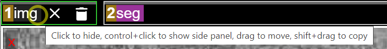{width=520 fig-alt="A layer tab showing the tooltip: click to hide, control+click to show side panel, drag to move, shift+drag to copy." fig-align="center"}

* **Click** a tab to turn that layer on or off.
*  a tab to open its side panel.
* **Drag** a tab to reorder it, or  to copy it.

### Coordinates

The coordinate readout shows the current position (in nanometers). Click it to
paste in a coordinate, or click the copy icon to copy the current location.

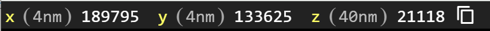{width=420 fig-alt="The coordinate readout showing x, y, and z positions with a copy button." fig-align="center"}

### Panel layout

Switch between layouts with the  key, or by clicking the
box-in-box icon in the upper corner of any panel. You can choose a 1-panel,
2-panel, or 4-panel view.

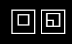{width=140 fig-alt="The box-in-box layout toggle icons." fig-align="center"}

::: {.grid}
::: {.g-col-12 .g-col-sm-4}
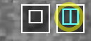{fig-alt="Two-panel layout." fig-align="center"}

**2 panel** — a 2D slice beside the 3D view.
:::
::: {.g-col-12 .g-col-sm-4}
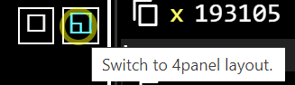{fig-alt="Four-panel layout." fig-align="center"}

**4 panel** — three 2D slices plus the 3D view.
:::
::: {.g-col-12 .g-col-sm-4}
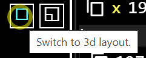{fig-alt="Single 3D panel layout." fig-align="center"}

**3D only** — just the 3D view.
:::
:::

The **xy** plane is in the plane of imaging and has the highest resolution; the
default 2-panel view is **xy-3d**.

## 3D navigation

These actions work in the **3D panel** (the right panel by default).

::: {.grid .mb-4}
::: {.g-col-12 .g-col-md-7}
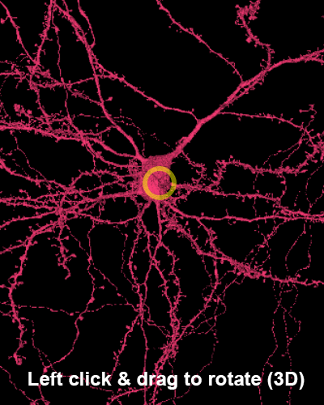{fig-alt="Left click and drag rotates the 3D view around the centered point." fig-align="center"}
:::
::: {.g-col-12 .g-col-md-5}
**Rotate** —  + drag.
:::
:::

::: {.grid .mb-4}
::: {.g-col-12 .g-col-md-7}
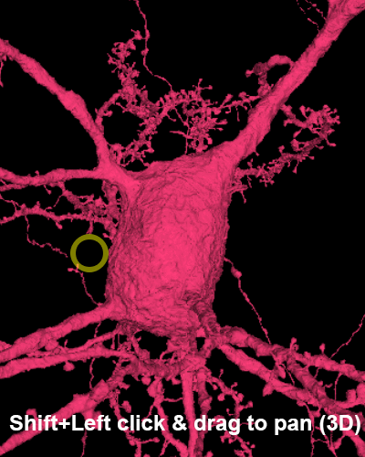{fig-alt="Shift plus left click and drag pans the 3D view." fig-align="center"}
:::
::: {.g-col-12 .g-col-md-5}
**Pan** —  +  + drag.
:::
:::

::: {.grid .mb-4}
::: {.g-col-12 .g-col-md-7}
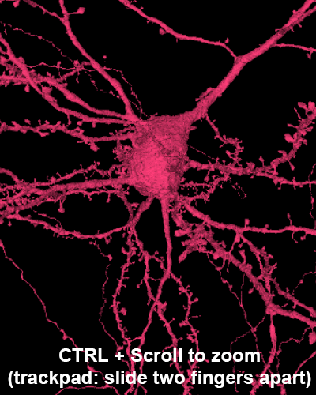{fig-alt="Hovering over the 3D panel and Ctrl plus scroll zooms." fig-align="center"}
:::
::: {.g-col-12 .g-col-md-5}
**Zoom** — .
:::
:::

::: {.grid .mb-4}
::: {.g-col-12 .g-col-md-7}
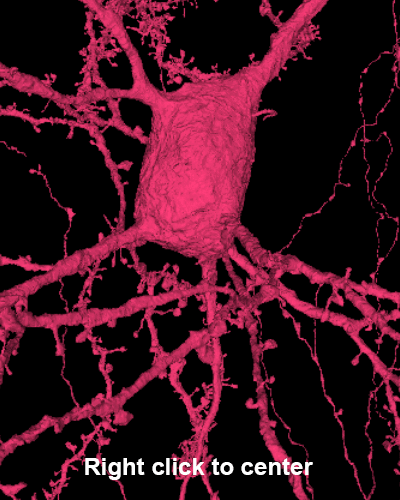{fig-alt="Right clicking an object centers it in every panel." fig-align="center"}
:::
::: {.g-col-12 .g-col-md-5}
**Center in every panel** — .
:::
:::

## 2D navigation

These actions work in the **2D image panels** (the left panel by default).

::: {.grid .mb-4}
::: {.g-col-12 .g-col-md-7}
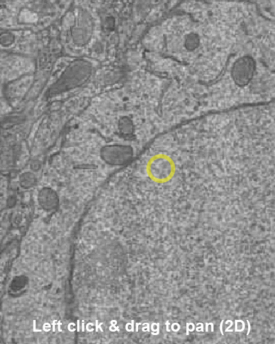{fig-alt="Click and drag pans the 2D EM image." fig-align="center"}
:::
::: {.g-col-12 .g-col-md-5}
**Pan** —  + drag.
:::
:::

::: {.grid .mb-4}
::: {.g-col-12 .g-col-md-7}
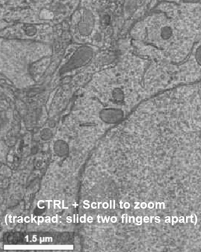{fig-alt="Hovering over the image panel and Ctrl plus scroll zooms." fig-align="center"}
:::
::: {.g-col-12 .g-col-md-5}
**Zoom** — .
:::
:::

::: {.grid .mb-4}
::: {.g-col-12 .g-col-md-7}
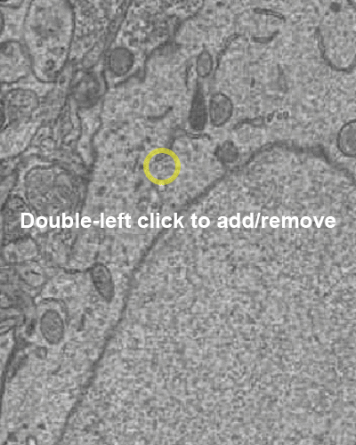{fig-alt="Double clicking a cell selects it; double clicking again deselects it." fig-align="center"}
:::
::: {.g-col-12 .g-col-md-5}
**Select / deselect a cell** — .
:::
:::

::: {.grid .mb-4}
::: {.g-col-12 .g-col-md-7}
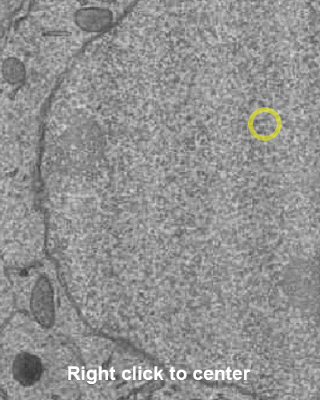{fig-alt="Right clicking centers the clicked point in every panel." fig-align="center"}
:::
::: {.g-col-12 .g-col-md-5}
**Center in every panel** — .
:::
:::

## Controlling perspective and overlays

These toggles change how the scene is displayed.

::: {.grid .mb-4}
::: {.g-col-12 .g-col-md-7}
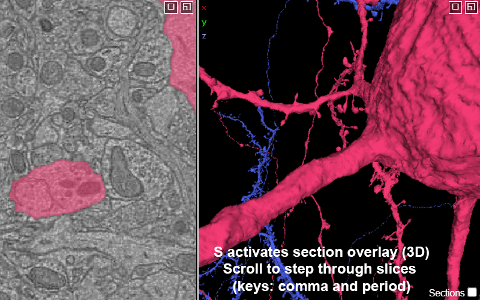{fig-alt="Scrolling over the image panel moves between slices of the volume." fig-align="center"}
:::
::: {.g-col-12 .g-col-md-5}
**Add section overlay** —  toggles to add the current section(s) from the 2D views to 3D.

**Move through the section slices** — mouse wheel, or  / .
:::
:::

::: {.grid .mb-4}
::: {.g-col-12 .g-col-md-7}
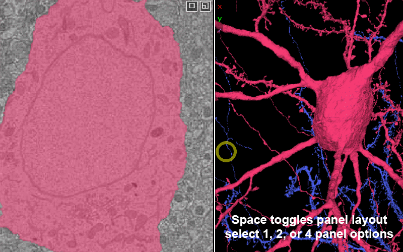{fig-alt="Pressing space cycles through the panel layouts." fig-align="center"}
:::
::: {.g-col-12 .g-col-md-5}
**Cycle panel layouts** — .
:::
:::

::: {.grid .mb-4}
::: {.g-col-12 .g-col-md-7}
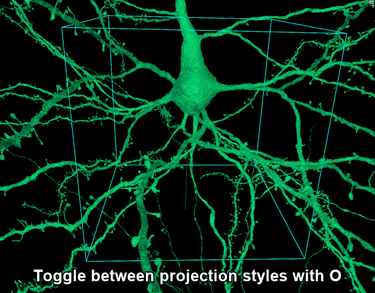{fig-alt="Pressing O toggles between perspective and orthographic projection; a scale bar appears in the orthographic view." fig-align="center"}
:::
::: {.g-col-12 .g-col-md-5}
**Toggle projection style** — . Switches between perspective and
orthographic views. Orthographic equalizes depth, so a scale bar appears.
:::
:::

## Visualization

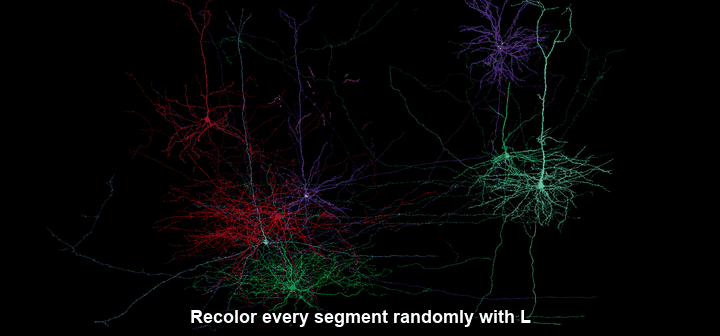{fig-alt="Pressing L assigns a fresh random color to every visible segment." fig-align="center"}

**Recolor all segments** — . Assigns a fresh random color to every
segment, which can help when neighboring cells overlap.

## Toolbar & settings

The toolbar in the upper-right corner opens the side panels and tools:

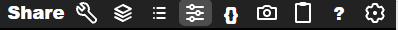{fig-alt="The Neuroglancer top-right toolbar with Share, Layers, Selection, Controls, JSON, Help, and Settings icons." fig-align="center"}

| Icon | Opens | What it does |
|:--:|:--|:--|
| {width=50 fig-alt="Share"} | **Share** | Creates a shareable, **shortened link** that captures your current view, visible segments, and annotations. |
| {width=30 fig-alt="Wrench"} | **Palette** | Shows the tool palette list (includes default Shader Controls). |
| {width=30 fig-alt="Layers"} | **Layers** | Shows the list of data layers (images, segmentations, annotations). |
| {width=30 fig-alt="Bullet List"} | **Details** | Shows details submenu for whatever you have selected. |
| {width=30 fig-alt="Sliders"} | **Controls** | Opens layer side panel, controls for the active layer (color, opacity, shaders). |
| {width=30 fig-alt="Curly brackets"} | **JSON** | Opens the raw JSON state — the full, editable definition of the scene. |
| {width=30 fig-alt="Camera"} | **Screenshot** | Opens the built in screenshot tool. |
| {width=30 fig-alt="Clipboard"} | **Copy URL** | Copy the full URL to the clipboard.|
| {width=30 fig-alt="Question Mark"} | **Shortcuts** | Lists every keyboard and mouse binding. |
| {width=30 fig-alt="Gear"} | **Settings** | Global settings (axis lines, scale bar, memory limits, backgrounds). |

: {.bordered tbl-colwidths="[22,18,60]"}

The **Settings** (gear) panel controls display options for the whole viewer:

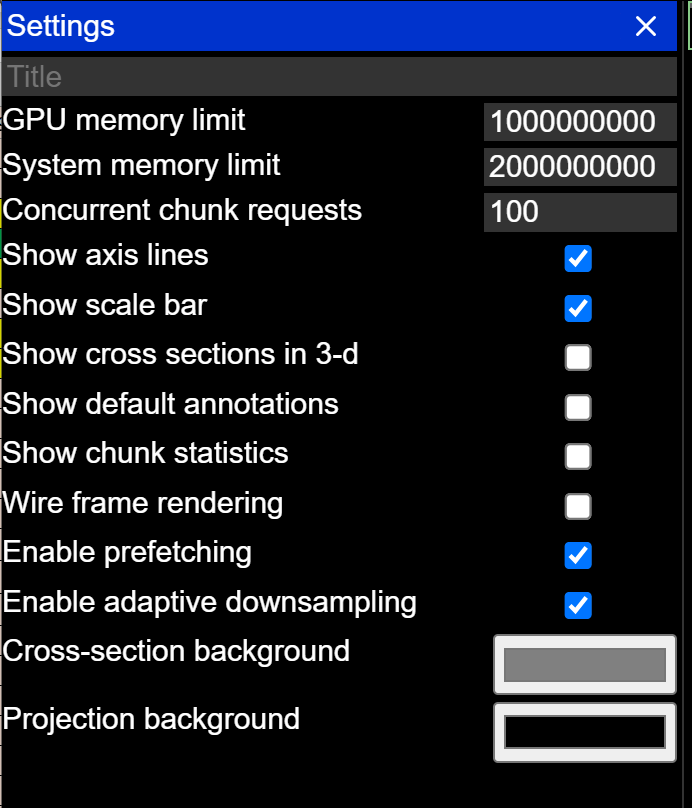{width=360 fig-alt="The Neuroglancer Settings side panel with options such as Show axis lines and Show scale bar." fig-align="center"}

## Keyboard shortcuts

| Key | Action |
|:--:|:--|
|  + drag | Rotate (3D) / pan (2D) |
|  +  + drag | Pan (3D) |
|  | Center the clicked point in every panel |
|  | Zoom |
| Mouse wheel | Move between slices |
|  /  | Move between slices |
|  | Cycle panel layouts |
|  | Show / hide the colored axis lines |
|  | Show / hide the 2D slice in the 3D view |
|  | Recolor all segments globally |
|  | Switch between 3D orthographic and projection views |
|  | Snap to the nearest axis (also undoes a sheared 2D view) |

: {.bordered tbl-colwidths="[35,65]"}

::: {.callout-tip}
Pressing  is handy if you have "sheared" the 2D view with
 +  + drag and want to return to the
original orientation.
:::
